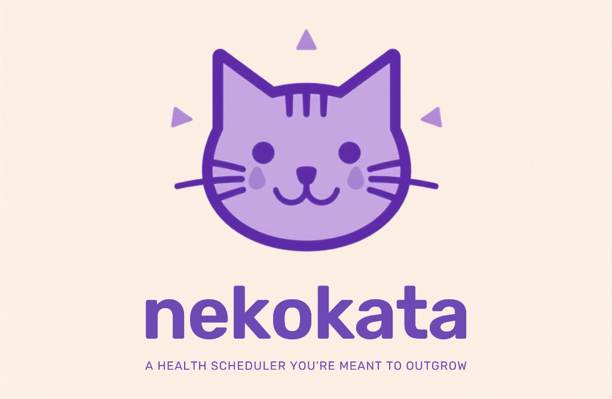
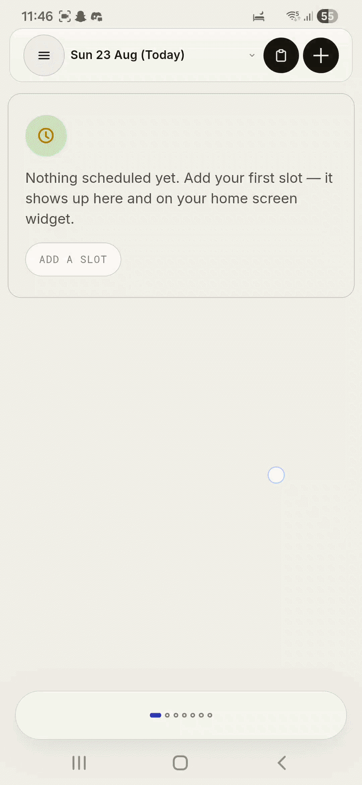

# nekokata

<p align="center">
  
</p>

Local-first. No account. Export everything and delete it.

Offline daily planner for Android. Schedule, habits, body, water, and todos sit on the device, no cloud, no subscription. The home-screen widget answers “what now?” without opening the app.

<p align="center">
  
</p>

## What's here

- `www/` is the app (`index.html` holds most of the UI and logic)
- `android/` is the native project. Open **this folder** in Android Studio, not the repo root
- `capacitor.config.json` is app id `com.nekokata.app`, name `nekokata`
- `AGENTS.md` is setup, test, deploy, and product rules for contributors and coding agents
- `PRIVACY.md` is what stays on the device
- `LICENSE` is hobby use only (private individual, not commercial, not for organisations)

## Build

1. From the project root (Node.js required):

   ```
   npm install
   npm run sync:android
   ```

2. Android Studio → File → Open → `android/`
3. Let Gradle sync finish (first run pulls SDK packages, needs internet)
4. Hit Run, or Build → Build APK(s)
5. For installs on other phones: Build → Generate Signed Bundle / APK. Copy the file into `releases/` (gitignored). Do not commit a keystore or an APK. Public binaries go on GitHub Releases, not in git.

## Editing the app

Change files under `www/`, then:

```
npm run sync:android
```

Rebuild in Android Studio. Data stays on the device in `localStorage`, sync only copies web files into the APK. Keys use the `nekokata:` prefix.

### UI / theme

Single **light** theme (`html[data-theme="light"]`), editorial paperwork, cream paper, Inter + Roboto Mono, nekokata blue `#2A38B1`.

- Shared shell styles (header, nav drawer, bottom bar, carousel): `www/styles/shell-chrome.css`
- Theme tokens: `www/styles/themes-light.css`
- Agent rule: `.cursor/rules/dual-theme-ui.mdc`

## Stability pass (SYS-01 / SYS-02)

After UI or navigation changes, run the regression checklist below on a device (or emulator) following `npm run sync:android`.

### Transition discipline (SYS-01)

Animated shell layers (nav drawer, screen swap, carousel swipe, live island) must not overlap or race. These rules live in `www/index.html` and `www/styles/shell-chrome.css`, follow them when adding overlays, sheets, or route changes.

| Rule | What it means | Where it lives |
|------|----------------|----------------|
| **One layer at a time** | Do not start a second transition while drawer close, screen nav, or carousel step is in flight. | `screenNavLock`, `carouselNavBusy`, `navDrawerClosing` |
| **Outgoing before incoming** | Hide the current screen (or close the drawer) before revealing the next screen. | `showScreenImpl()` awaits `closeNav()`, then toggles `.screen.hidden` |
| **Awaited `closeNav()`** | Every navigation path must await drawer close (~220 ms), never call `showScreen` while drawer is open. | `closeNav()` → `waitNavDrawerTransition()` |
| **`pointercancel` clears press** | Pressed affordances use `.is-pressing`, cleared on `pointerup` **and** `pointercancel`. | `#navDrawer` press handler, same pattern on checkboxes / scrubbers |
| **Body lock in `finally`** | Scroll lock (`html.nav-open`) is removed when close finishes, even if transition errors. | `closeNav()` `.finally()`, CSS in `shell-chrome.css` |

**Single source of truth:** `navDrawerOpen` drives drawer DOM, hamburger icon (`sym-menu` / `sym-close`), and `aria-expanded`. Use `isNavDrawerActive()` (open **or** closing) to gate swipe/carousel.

**Adding a new animated overlay:** expose `openX()` / `closeX()` where `closeX()` returns a Promise, gate interactions with `isXActive()`, release scroll-lock and press states in `.finally()`.

Agent rule: `.cursor/rules/transition-discipline.mdc`

### Manual regression (SYS-02)

Run on device after `npm run sync:android`. Pass = no crash, no stuck UI, no visual desync.

1. **Drawer toggle ×5.** Open and close the hamburger menu five times. Icon stays menu ↔ close in sync with drawer, no stuck teal row highlight.
2. **Drawer-nav then swipe.** Open drawer, tap a screen, immediately swipe left/right on the carousel. No crash, correct screen stays visible.
3. **Scroll every screen.** Visit each screen in the carousel and scroll content. Smooth scroll, bottom Now Bar / dots remain usable (no truncation glitches).
4. **Water presets.** On Water, tap 150 / 250 / 350 / bottle. Ring updates on one tap, keyboard does not appear unless **Custom** is opened.
5. **Date format.** Check top pill, home day picker, stats range, nutrition/measurements date labels, and history tables. All show the same display format (`Sun 5 Jul` style via `formatDate()`).

## License

Hobby use only. See `LICENSE`. You can run and tinker with nekokata as a private individual, not for commercial use and not on behalf of an organisation. Fonts in `www/fonts/` keep their upstream licenses (SIL OFL 1.1 for Inter, Apache 2.0 for Roboto Mono).

## Icons

Launcher icons: `android/app/src/main/res/mipmap-*` (adaptive foreground is the mipmap PNG). Web icons: `www/icon-192.png`, `www/icon-512.png`, `www/icons/brand-mark.png`, `www/icons/brand-lockup.png`. README banner: `www/icons/readme-banner.png`. README demo: `nekokata.gif`.
